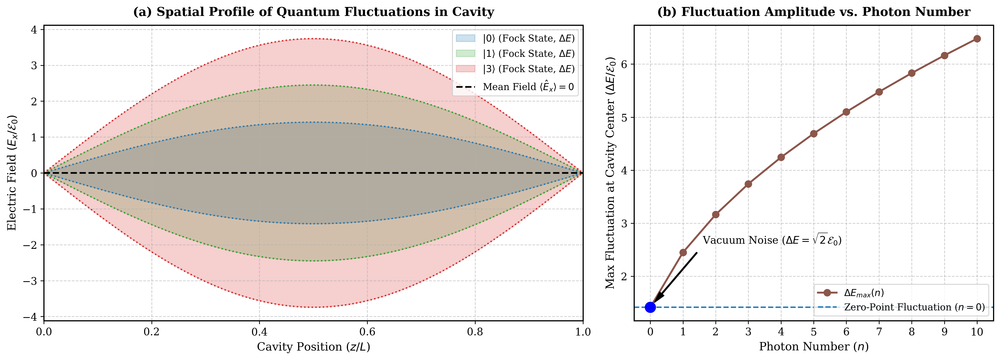
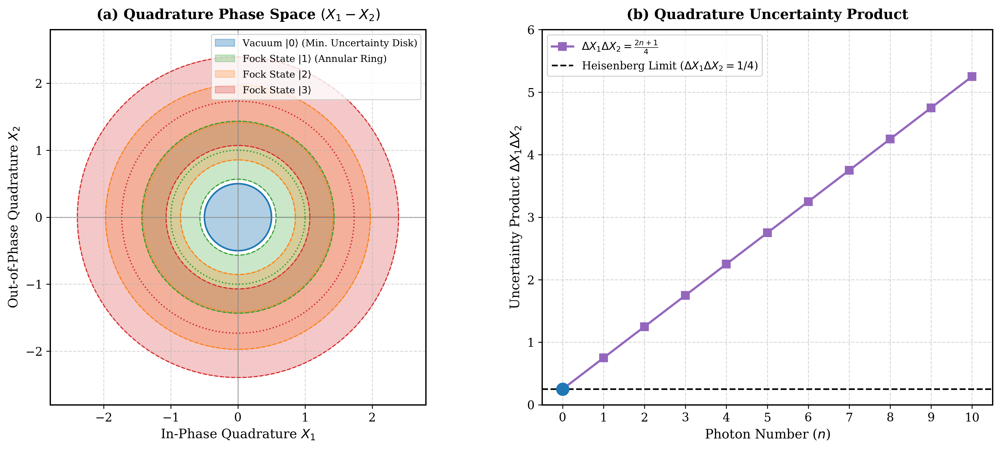

# Quantum Optics Simulations (Gerry & Knight)

Interactive computational simulations of core concepts based on **"Introductory Quantum Optics" by Christopher C. Gerry and Sir Peter L. Knight**.

---

### 1. Single-Mode Quantum Field Fluctuations & Vacuum Noise
**Reference:** Chapter 2 (*Field Quantization*), Section 2.2: *Quantum Fluctuations of a Single-Mode Field*

#### The Physics & Mathematics
In classical optics, an empty cavity contains no energy and the electric field is strictly zero everywhere. In quantum optics, the quantized electric field operator inside a single-mode 1D cavity along the $z$-axis is:
$$\hat{E}_x(z, t) = \mathcal{E}_0 \left(\hat{a} e^{-i\omega t} + \hat{a}^\dagger e^{i\omega t}\right) \sin(kz)$$

For a photon number state (Fock state $|n\rangle$):
- **Expectation value is identically zero:**
  $$\langle n | \hat{E}_x(z, t) | n \rangle = 0$$
- **Field variance (quantum fluctuation envelope) is non-vanishing:**
  $$\Delta E_x(z) = \sqrt{\langle \hat{E}_x^2 \rangle - \langle \hat{E}_x \rangle^2} = 2 \mathcal{E}_0 \sqrt{n + \frac{1}{2}} |\sin(kz)|$$

For the vacuum state ($n = 0$), the zero-point energy yields an irreducible vacuum noise:
$$\Delta E_{\text{vac}}(z) = \sqrt{2} \mathcal{E}_0 |\sin(kz)|$$

#### Simulation Output

#### Physical Interpretation
1. **Uncertainty Envelope:** Even though the classical expectation value of the field is zero, there exists a standing-wave uncertainty envelope of amplitude $2 \mathcal{E}_0 \sqrt{n + 1/2}$.
2. **Vacuum Fluctuations:** In absolute darkness ($|0\rangle$), the field variance does not vanish. These vacuum fluctuations are responsible for spontaneous emission, the Lamb shift, and the Casimir effect.

---

### 2. Quadrature Operators & Phase Space Uncertainty Disks
**Reference:** Chapter 2 (*Field Quantization*), Section 2.3: *Quadrature Operators for a Single-Mode Field*

#### The Physics & Mathematics
The non-Hermitian creation and annihilation operators ($\hat{a}, \hat{a}^\dagger$) can be decomposed into two dimensionless, Hermitian quadrature operators:
$$\hat{X}_1 = \frac{1}{2}(\hat{a} + \hat{a}^\dagger), \quad \hat{X}_2 = \frac{1}{2i}(\hat{a} - \hat{a}^\dagger)$$

These operators satisfy the commutation relation $[\hat{X}_1, \hat{X}_2] = \frac{i}{2}$, imposing the Heisenberg uncertainty relation:
$$\Delta X_1 \Delta X_2 \ge \frac{1}{4}$$

For any Fock state $|n\rangle$:
- **Mean values vanish:** $\langle n | \hat{X}_1 | n \rangle = \langle n | \hat{X}_2 | n \rangle = 0$
- **Isotropic fluctuations:**
  $$\Delta X_1 = \Delta X_2 = \sqrt{\frac{2n + 1}{4}}$$
- **Uncertainty product:**
  $$\Delta X_1 \Delta X_2 = \frac{2n + 1}{4}$$

The ground state (vacuum $|0\rangle$) achieves the minimum uncertainty bound: $\Delta X_1 \Delta X_2 = 1/4$.

#### Simulation Output

#### Physical Interpretation
1. **Minimum Uncertainty Vacuum Disk:** The ground state $|0\rangle$ is an isotropic circle of radius $1/2$ at the origin, setting the fundamental quantum noise floor.
2. **Phase Indeterminacy of Fock States:** A state with a well-defined photon number ($\Delta n = 0$) has a completely undefined phase ($\phi \in [0, 2\pi)$). Consequently, Fock states appear in phase space as concentric annular rings centered at radius $\sqrt{n}$.
3. **Linear Uncertainty Growth:** The uncertainty area in phase space grows linearly with photon number $n$.
