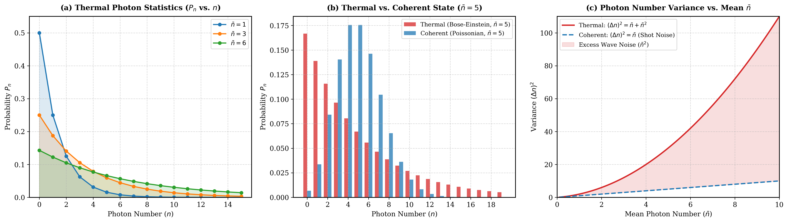

# Chapter 2: Field Quantization
### Numerical Simulations & Visual Interpretations
Based on **"Introductory Quantum Optics" by Christopher C. Gerry and Sir Peter L. Knight**, Chapter 2: *Field Quantization*.

---

## 📌 Chapter Overview
This folder contains computational models and phase-space representations illustrating the quantum nature of single-mode electromagnetic fields inside an optical cavity.

-  **1. Single-Mode Quantum Field Fluctuations & Vacuum Noise** (Sec. 2.2)
-  **2. Quadrature operators for a single-modefield** (Sec. 2.3)
-  **3. Photon Number Statistics: Thermal vs. Coherent Light** (Sec. 2.5) 
-  **4. Zero-Point Energy & Casimir Effect Regularization** (Sec. 2.6) *(Next)*

---

### 1. Single-Mode Quantum Field Fluctuations & Vacuum Noise
**Reference:** Chapter 2 (*Field Quantization*), Section 2.2: *Quantum Fluctuations of a Single-Mode Field*

#### The Physics & Mathematics
In classical optics, an empty cavity contains no energy, and the electric field is identically zero everywhere. In quantum optics, the electric field operator inside a 1D single-mode cavity along the $z$-axis is quantized as:
$$\hat{E}_x(z, t) = \mathcal{E}_0 \left(\hat{a} e^{-i\omega t} + \hat{a}^\dagger e^{i\omega t}\right) \sin(kz)$$

where $\mathcal{E}_0 = \sqrt{\frac{\hbar \omega}{\epsilon_0 V}}$ is the electric field per photon, and $\hat{a}, \hat{a}^\dagger$ are the bosonic annihilation and creation operators.

For any photon number state (Fock state $|n\rangle$):
- **Expectation value vanishes everywhere:**
  $$\langle n | \hat{E}_x(z, t) | n \rangle = 0$$
- **Field uncertainty (fluctuation envelope) is non-vanishing:**
  $$\Delta E_x(z) = \sqrt{\langle \hat{E}_x^2 \rangle - \langle \hat{E}_x \rangle^2} = 2 \mathcal{E}_0 \sqrt{n + \frac{1}{2}} |\sin(kz)|$$

For the vacuum state ($n = 0$), zero-point energy induces irreducible quantum fluctuations:
$$\Delta E_{\text{vac}}(z) = \sqrt{2} \mathcal{E}_0 |\sin(kz)|$$

#### Simulation Output

#### Detailed Plot Guide & Analysis
* **Subplot (a) — Spatial Profile of Quantum Fluctuations:**
  * **X-Axis ($z/L$):** Normalized spatial coordinate along the cavity axis, from mirror $z = 0$ to mirror $z = 1$.
  * **Y-Axis ($E_x / \mathcal{E}_0$):** Normalized electric field amplitude.
  * **Black Dashed Line ($\langle E \rangle = 0$):** The classical average of the field is exactly zero everywhere across the cavity at all times.
  * **Colored Shaded Bands ($\pm \Delta E$):** The quantum uncertainty envelope around the zero mean. Because the field is constrained by perfectly conducting cavity walls, fluctuations vanish at the mirrors ($z=0, 1$) and reach maximum amplitude at the antinode ($z/L = 0.5$).
  * **Blue Band ($|0\rangle$ Vacuum State):** **The primary quantum takeaway!** Even with zero photons in the cavity, the field is never quiescent; it fluctuates within an envelope of $\pm \sqrt{2}\mathcal{E}_0$.
  * **Green ($|1\rangle$) & Red ($|3\rangle$) Bands:** Injecting photons expands the variance envelope proportional to $\sqrt{n + 1/2}$.

* **Subplot (b) — Fluctuation Amplitude vs. Photon Number:**
  * **X-Axis ($n$):** Cavity photon number ($n = 0, 1, 2, \dots, 10$).
  * **Y-Axis:** Peak field uncertainty at the antinode center ($z = L/2$).
  * **Blue Dot at $n=0$:** Highlights the irreducible zero-point vacuum noise floor ($\Delta E \approx 1.414 \mathcal{E}_0$).
  * **Brown Curve:** Demonstrates that the field fluctuation amplitude grows sub-linearly with excitation number as $\sim \sqrt{n + 1/2}$.

---

### 2. Quadrature Operators & Phase Space Uncertainty Disks
**Reference:** Chapter 2 (*Field Quantization*), Section 2.3: *Quadrature Operators for a Single-Mode Field*

#### The Physics & Mathematics
The non-Hermitian ladder operators ($\hat{a}, \hat{a}^\dagger$) can be decomposed into two dimensionless, Hermitian quadrature operators:
$$\hat{X}_1 = \frac{1}{2}(\hat{a} + \hat{a}^\dagger), \quad \hat{X}_2 = \frac{1}{2i}(\hat{a} - \hat{a}^\dagger)$$

These operators are optical analogues of dimensionless position and momentum, obeying the fundamental commutation relation $[\hat{X}_1, \hat{X}_2] = \frac{i}{2}$, which establishes the Heisenberg uncertainty relation:
$$\Delta X_1 \Delta X_2 \ge \frac{1}{4}$$

For any Fock state $|n\rangle$:
- **Mean quadrature values vanish:** $\langle n | \hat{X}_1 | n \rangle = \langle n | \hat{X}_2 | n \rangle = 0$
- **Isotropic uncertainties:**
  $$\Delta X_1 = \Delta X_2 = \sqrt{\frac{2n + 1}{4}}$$
- **Uncertainty product:**
  $$\Delta X_1 \Delta X_2 = \frac{2n + 1}{4}$$

For the vacuum state ($n = 0$), the equality holds ($\Delta X_1 \Delta X_2 = 1/4$), proving that the **vacuum is an ideal minimum-uncertainty state**.

#### Simulation Output

#### Detailed Plot Guide & Analysis
* **Subplot (a) — Quadrature Phase Space $(X_1 - X_2)$:**
  * **Axes ($X_1, X_2$):** Represent the in-phase and out-of-phase field amplitudes (equivalent to real and imaginary components of the complex optical field).
  * **Blue Solid Disk ($|0\rangle$ Vacuum State):** Classically, a quiescent field would be a point at $(0, 0)$. In quantum optics, the uncertainty principle enforces a minimum fuzzy area: a circular disk of radius $\Delta X = 1/2$.
  * **Concentric Rings ($|1\rangle, |2\rangle, |3\rangle$ Fock States):** 
    * Why rings? In a Fock state, the photon number $n$ is known with zero uncertainty ($\Delta n = 0$). By the quantum number-phase complementarity, its optical phase $\phi$ is completely undefined and uniformly distributed over $[0, 2\pi)$.
    * The ring has mean radius $\sqrt{n}$, and its radial thickness matches the quantum quadrature noise.
  * **Phase Symmetry:** All states are strictly rotationally symmetric around $(0,0)$, confirming that number states carry no preferred optical phase.
 
  * ---

---

### 3. Photon Number Statistics: Thermal Fields vs. Coherent States
**Reference:** Chapter 2 (*Field Quantization*), Section 2.5: *Thermal Fields*

#### The Physics & Mathematics
A single-mode field in thermal equilibrium with a heat reservoir at temperature $T$ is in a statistical mixture described by the thermal density operator:

$$
\hat{\rho}_{\mathrm{th}} = \frac{e^{-\hat{H}/k_B T}}{\mathrm{Tr}\left[e^{-\hat{H}/k_B T}\right]} = \sum_{n=0}^{\infty} P_n |n\rangle \langle n|
$$

where $\hat{H} = \hbar \omega \left(\hat{a}^\dagger \hat{a} + \frac{1}{2}\right)$. The average photon number is given by Planck's distribution:

$$
\bar{n} = \langle \hat{n} \rangle = \frac{1}{e^{\hbar \omega / k_B T} - 1}
$$

where $\hat{H} = \hbar \omega \left(\hat{a}^\dagger \hat{a} + \frac{1}{2}\right)$. The average photon number is given by Planck's distribution:
$$\bar{n} = \langle \hat{n} \rangle = \frac{1}{e^{\hbar \omega / k_B T} - 1}$$

The probability distribution of finding exactly $n$ photons in the mode follows the **Bose-Einstein distribution**:
$$P_n = \frac{1}{1 + \bar{n}} \left(\frac{\bar{n}}{1 + \bar{n}}\right)^n = \frac{\bar{n}^n}{(1 + \bar{n})^{n+1}}$$

The photon number variance exhibits an essential difference compared to coherent light:
$$(\Delta n)^2 = \langle \hat{n}^2 \rangle - \langle \hat{n} \rangle^2 = \bar{n} + \bar{n}^2$$

- **$\bar{n}$ (Shot noise / Particle nature):** The standard quantum Poissonian noise.
- **$\bar{n}^2$ (Wave noise / Photon bunching):** Extra intensity fluctuations arising from interference between random thermal wave packets. Because $(\Delta n)^2 > \bar{n}$, thermal light is strictly **super-Poissonian**.

#### Simulation Output

#### Detailed Plot Guide & Analysis
* **Subplot (a) — Thermal Distributions ($P_n$ vs. $n$):**
  * **X-Axis ($n$):** Discrete photon number ($0, 1, 2, \dots$).
  * **Y-Axis ($P_n$):** Probability of measuring $n$ photons.
  * **Exponential Decay Profile:** Notice that for any temperature (any $\bar{n}$), the curve decays monotonically. 
  * **The Zero-Photon Paradox:** The most probable photon number in thermal light is **always zero** ($P_0 = \frac{1}{1+\bar{n}} > P_n$ for all $n \ge 1$), even when the average photon number is large (e.g., $\bar{n} = 6$).
* **Subplot (b) — Thermal vs. Coherent Light ($\bar{n} = 5$):**
  * **Red Bars (Thermal Light):** Shows maximum probability at $n=0$ and drops monotonically. Photons arrive in bunches.
  * **Blue Bars (Coherent / Laser Light):** Follows a Poissonian distribution peaked around the mean ($n \approx \bar{n} = 5$). Photons arrive independently with no correlations.
  * **Contrast:** While a laser produces a predictable amplitude with a well-defined Poisson peak, thermal light has massive fluctuations around zero.
* **Subplot (c) — Photon Number Variance (Super-Poissonian Noise):**
  * **X-Axis ($\bar{n}$):** Mean photon number.
  * **Y-Axis ($(\Delta n)^2$):** Photon number variance.
  * **Blue Dashed Line (Coherent / Shot Noise):** Linear relation $(\Delta n)^2 = \bar{n}$.
  * **Red Solid Curve (Thermal):** Quadratic relation $(\Delta n)^2 = \bar{n} + \bar{n}^2$.
  * **Shaded Region (Excess Wave Noise):** Highlights the quadratic excess noise $\bar{n}^2$ responsible for the Hanbury Brown–Twiss effect (photon bunching).
