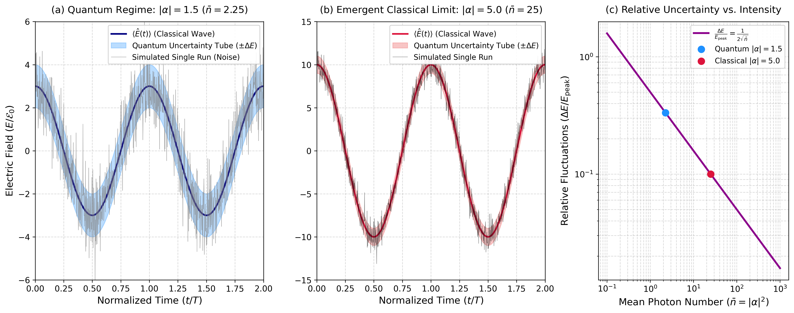
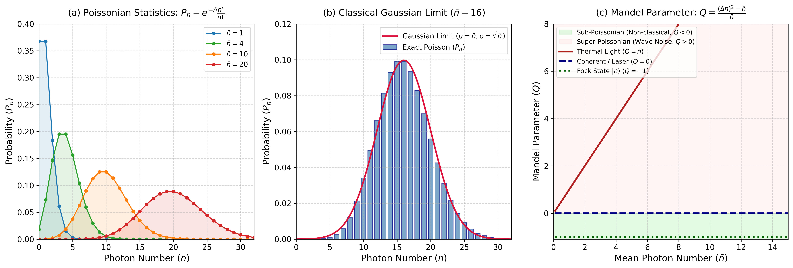
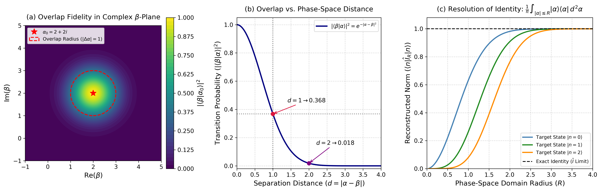
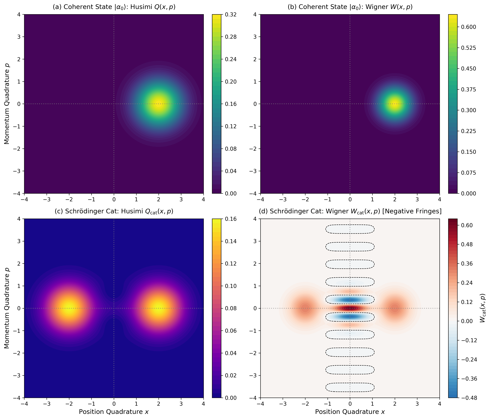

# Chapter 3: Coherent States of Light
### Numerical Simulations & Visual Interpretations
Based on **"Introductory Quantum Optics" by Christopher C. Gerry and Sir Peter L. Knight**, Chapter 3: *Coherent States*.

---

## 📌 Chapter Overview
This folder contains computational models, phase-space visualizations, and statistical analyses illustrating the quasi-classical nature, quantum non-orthogonality, and phase-space representations of Glauber coherent states.

- **1. Classical Limit & Electric Field Dynamics with Quantum Noise Tube** (Sec. 3.1 & 3.5)
- **2. Photon Number Statistics & Mandel Q-Parameter** (Sec. 3.2)
- **3. Quantum Non-Orthogonality & Overcompleteness in Phase Space** (Sec. 3.2)
- **4. Phase-Space Quasi-Probability Distributions: Husimi Q, Wigner W & Schrödinger Cat** (Sec. 3.3 & 3.6)

---

### 1. Classical Limit & Electric Field Dynamics with Quantum Noise Tube
**Reference:** Chapter 3 (*Coherent States*), Section 3.3: *Wave packets and time evolution*

#### The Physics & Mathematics
In Chapter 2, we showed that for any energy eigenstate (Fock state $|n\rangle$), the expectation value of the electric field vanishes identically at all times: $\langle n | \hat{E}(t) | n \rangle = 0$. Consequently, number states cannot describe the continuously oscillating classical electromagnetic waves generated by macroscopic sources or single-mode lasers.

To resolve this dichotomy, Roy J. Glauber introduced **coherent states** $|\alpha\rangle$, defined as right eigenstates of the non-Hermitian photon annihilation operator $\hat{a}$:
$$\hat{a} |\alpha\rangle = \alpha |\alpha\rangle, \quad \alpha \in \mathbb{C}$$

Parameterizing the complex eigenvalue in polar form as $\alpha = |\alpha| e^{i\theta}$, where $|\alpha| = \sqrt{\bar{n}}$ represents the field amplitude and $\theta$ is the initial optical phase. Under the free field Hamiltonian $\hat{H} = \hbar \omega (\hat{a}^\dagger \hat{a} + \frac{1}{2})$, the state evolves harmonically in time:
$$|\alpha(t)\rangle = e^{-i\omega t/2} |\alpha e^{-i\omega t}\rangle$$

Evaluating the expectation value of the quantized electric field operator $\hat{E}(t) = \mathcal{E}_0 \left(\hat{a} e^{-i\omega t} + \hat{a}^\dagger e^{i\omega t}\right)$ yields:
$$\langle \alpha | \hat{E}(t) | \alpha \rangle = \mathcal{E}_0 \left( \alpha e^{-i\omega t} + \alpha^* e^{i\omega t} \right) = 2 \mathcal{E}_0 |\alpha| \cos(\omega t - \theta)$$

This explicitly reproduces the **classical sinusoidal wave of Maxwellian electrodynamics** with a well-defined amplitude and optical phase!

Computing the field variance:
$$\langle \hat{E}^2(t) \rangle = \langle \hat{E}(t) \rangle^2 + \mathcal{E}_0^2 \implies \Delta E(t) = \sqrt{\langle \hat{E}^2 \rangle - \langle \hat{E} \rangle^2} = \mathcal{E}_0$$

##### Key Physical Takeaways:
1. **Constant Quantum Noise Tube:** Unlike squeezed states, the quantum uncertainty $\Delta E = \mathcal{E}_0$ of a coherent state is **strictly constant in time** and completely independent of the photon excitation number $\bar{n} = |\alpha|^2$. It maintains the identical zero-point noise floor of the vacuum state.
2. **The Classical Limit (Bohr's Correspondence Principle):**  
The peak electric field amplitude is $E_{\mathrm{peak}} = 2 \mathcal{E}_0 |\alpha| = 2 \mathcal{E}_0 \sqrt{\bar{n}}$. The relative quantum uncertainty (noise-to-signal ratio) is:

$$\frac{\Delta E}{E_{\mathrm{peak}}} = \frac{1}{2|\alpha|} = \frac{1}{2\sqrt{\bar{n}}} \to 0 \quad (\bar{n} \to \infty)$$

As the average photon number grows, the quantum fuzziness becomes an utterly negligible fraction of the macroscopic oscillation, recovering classical deterministic optics.

#### Simulation Output

#### Detailed Plot Guide & Analysis
* **Subplot (a) — Quantum-Dominant Regime ($|\alpha| = 1.5, \bar{n} = 2.25$):**
  * **Navy Blue Curve ($\langle \hat{E}(t) \rangle$):** The underlying quantum expectation value tracing a classical cosine oscillation.
  * **Dodgerblue Shaded Band ($\pm \Delta E$):** The irreducible quantum uncertainty tube. Because the mean photon number is small ($\bar{n} \approx 2$), the noise envelope covers a substantial fraction of the wave amplitude.
  * **Gray Trajectory:** A single simulated experimental shot-noise realization. It illustrates that instantaneous measurements scatter widely within the noise tube, proving that individual quantum runs are heavily stochastic.
* **Subplot (b) — Emergent Classical Limit ($|\alpha| = 5.0, \bar{n} = 25$):**
  * **Crimson Curve & Lightcoral Band:** As the excitation increases to $25$ photons, the field amplitude surges ($E_{\text{peak}} = 10\mathcal{E}_0$) while the uncertainty band remains pinned at $\pm \mathcal{E}_0$.
  * **Black Trajectory:** Individual measurement noise is now visibly constrained close to the classical trajectory, demonstrating how macroscopically stable laser fields emerge from microscopic photons.
* **Subplot (c) — Classical Limit Scaling (Noise-to-Signal Ratio vs. Intensity):**
  * **Axes:** Double logarithmic plot of relative field fluctuations ($\Delta E / E_{\text{peak}}$) against the mean photon count $\bar{n} \in [0.1, 1000]$.
  * **Dark Magenta Line:** Validates the theoretical power law $\frac{\Delta E}{E_{\text{peak}}} \propto \bar{n}^{-1/2}$.
  * **Highlighted Dots:** Contrast the quantum-dominated simulation point ($|\alpha| = 1.5$, where noise is $\sim 33\%$ of the peak signal) against the semi-classical point ($|\alpha| = 5.0$, where noise drops to $10\%$). At $1000$ photons, noise falls below $1.5\%$.
 
 ---
 
### 2. Photon Number Statistics & Mandel Q-Parameter
**Reference:** Chapter 3 (*Coherent States*), Section 3.1: *Eigenstates of the annihilation operator and minimum uncertainty states*

#### The Physics & Mathematics
In the Fock state basis $|n\rangle$, a Glauber coherent state $|\alpha\rangle$ is expressed as an infinite linear superposition:

$$|\alpha\rangle = e^{-|\alpha|^2 / 2} \sum_{n=0}^{\infty} \frac{\alpha^n}{\sqrt{n!}} |n\rangle$$

The probability of detecting exactly $n$ photons in the single-mode field follows by projection onto the Fock state $|n\rangle$:

$$P_n = |\langle n | \alpha \rangle|^2 = e^{-|\alpha|^2} \frac{|\alpha|^{2n}}{n!} = e^{-\bar{n}} \frac{\bar{n}^n}{n!}$$

where $\bar{n} = \langle \hat{n} \rangle = |\alpha|^2$ is the average photon number. This is an exact **Poisson distribution**, reflecting the independent and uncorrelated arrival of photons (shot noise).

Computing the photon number variance:

$$(\Delta n)^2 = \langle \hat{n}^2 \rangle - \langle \hat{n} \rangle^2 = \bar{n}$$

For a Poissonian field, the variance is identically equal to the mean ($(\Delta n)^2 = \bar{n}$), yielding a fractional photon number uncertainty of $\frac{\Delta n}{\bar{n}} = \frac{1}{\sqrt{\bar{n}}}$.

##### The Mandel $Q$-Parameter
To benchmark and classify the quantum statistical nature of any optical field against shot noise, Leonard Mandel introduced the dimensionless parameter:

$$Q = \frac{(\Delta n)^2 - \langle \hat{n} \rangle}{\langle \hat{n} \rangle} = \frac{(\Delta n)^2}{\bar{n}} - 1$$

- **$Q = 0$ (Poissonian / Shot-Noise Limit):** Characteristic of ideal coherent states and stabilized lasers operating well above threshold.
- **$Q > 0$ (Super-Poissonian / Wave Noise):** Typical of thermal and chaotic light ($(\Delta n)^2 = \bar{n} + \bar{n}^2 \implies Q = \bar{n} > 0$), where intensity fluctuations induce photon bunching.
- **$-1 \le Q < 0$ (Sub-Poissonian / Purely Non-Classical):** Light with reduced intensity fluctuations below the shot-noise floor. For an ideal Fock state $|n\rangle$, the photon variance is strictly zero, attaining the fundamental quantum limit $Q = -1$ (anti-bunched light).

##### The Gaussian Asymptotic Limit
For macroscopic fields ($\bar{n} \gg 1$), Stirling's approximation transforms the discrete Poisson distribution into a continuous Gaussian distribution:

$$P_n \approx \frac{1}{\sqrt{2\pi \bar{n}}} \exp\left[ -\frac{(n - \bar{n})^2}{2\bar{n}} \right]$$

#### Simulation Output

#### Detailed Plot Guide & Analysis
* **Subplot (a) — Poissonian Distribution Across Intensities:**
  * **Asymmetric to Symmetric Transition:** At low photon numbers ($\bar{n} = 1$), the distribution is heavily skewed toward zero. As $\bar{n}$ increases ($4, 10, 20$), the peak shifts rightward to $n \approx \bar{n}$ and becomes increasingly bell-shaped and symmetric.
  * **Absolute vs. Relative Width:** While the absolute variance $(\Delta n)^2 = \bar{n}$ expands with intensity, the relative spread $\Delta n / \bar{n} = 1/\sqrt{\bar{n}}$ contracts, sharpening the field's photon purity.
* **Subplot (b) — Classical Gaussian Limit ($\bar{n} = 16$):**
  * **Blue Bars:** The discrete quantum Poisson probabilities $P_n$.
  * **Crimson Curve:** The continuous classical Gaussian probability density function $\mathcal{N}(\mu=\bar{n}, \sigma=\sqrt{\bar{n}})$.
  * **Physical Consequence:** At macroscopic excitation numbers, quantum discrete photon granularity smooths out smoothly into classical Gaussian intensity statistics.
* **Subplot (c) — Mandel $Q$-Parameter Classification:**
  * **Horizontal Navy Dashed Line ($Q = 0$):** Identifies coherent light as the universal benchmark boundary between classical and quantum optics.
  * **Light Green Zone ($Q < 0$):** The forbidden classical region populated exclusively by non-classical states. The dotted green line at $Q = -1$ marks the absolute lower bound achieved by number states $|n\rangle$.
  * **Misty Rose Zone ($Q > 0$):** The classical super-Poissonian domain. The solid firebrick curve illustrates how thermal wave noise scales linearly ($Q = \bar{n}$), drifting rapidly away from Poissonian coherence.
 
 --- 
 
### 3. Quantum Non-Orthogonality & Overcompleteness in Phase Space
**Reference:** Chapter 3 (*Coherent States*), Section 3.5: *More on the properties of coherent states*

#### The Physics & Mathematics
Unlike the discrete, mutually orthogonal Fock basis ($\langle m | n \rangle = \delta_{mn}$), coherent states are **never strictly orthogonal**. Using their Fock expansions, the inner product between two arbitrary coherent states $|\alpha\rangle$ and $|\beta\rangle$ is:

$$\langle \beta | \alpha \rangle = e^{-\frac{1}{2}(|\alpha|^2 + |\beta|^2)} \sum_{n=0}^{\infty} \frac{(\beta^* \alpha)^n}{n!} = \exp\left[ -\frac{1}{2}(|\alpha|^2 + |\beta|^2) + \beta^* \alpha \right]$$

The transition probability (quantum overlap fidelity) is given by:

$$|\langle \beta | \alpha \rangle|^2 = \exp\left( -|\alpha - \beta|^2 \right)$$

##### Key Physical Consequences:
1. **Fundamental Non-Orthogonality:** Because $|\langle \beta | \alpha \rangle|^2 > 0$ for any finite complex amplitudes $\alpha$ and $\beta$, no quantum measurement can discriminate between two coherent states with $100\%$ determinism. This non-orthogonality constitutes the physical foundation of continuous-variable quantum key distribution (CV-QKD) and the B92 protocol.
2. **Quasi-Orthogonality:** The overlap decays exponentially with the squared Euclidean distance in phase space ($d^2 = |\alpha - \beta|^2$). When the separation satisfies $|\alpha - \beta| \ge 3$, the overlap falls below $e^{-9} \approx 1.23 \times 10^{-4}$, rendering the states practically distinguishable.
3. **Overcompleteness & Resolution of the Identity:**  
   Because coherent states are non-orthogonal, they form an overcomplete basis set. The resolution of the identity operator is expressed as an integral over the entire complex plane:

$$\frac{1}{\pi} \int |\alpha\rangle\langle \alpha| \, d^2\alpha = \hat{\mathbb{I}}$$

where $d^2\alpha = d(\mathrm{Re}\,\alpha) \, d(\mathrm{Im}\,\alpha)$. Any quantum state can be expanded in coherent states, although the expansion is non-unique.

Projecting an arbitrary Fock state $|n\rangle$ onto this identity resolution within a bounded circular disk of radius $R$ in phase space yields:

$$\langle n | \hat{\mathbb{I}}_R | n \rangle = \frac{1}{\pi} \int_{|\alpha| \le R} |\langle \alpha | n \rangle|^2 \, d^2\alpha = 1 - e^{-R^2} \sum_{k=0}^{n} \frac{R^{2k}}{k!} \longrightarrow 1 \quad (R \to \infty)$$

#### Simulation Output

#### Detailed Plot Guide & Analysis
* **Subplot (a) — Overlap Fidelity in Complex $\beta$-Plane:**
  * **2D Color Gradient:** Evaluates the transition probability $|\langle \beta | \alpha_0 \rangle|^2$ for a target coherent state $\alpha_0 = 2 + 2i$.
  * **Red Dashed Circle ($|\Delta \alpha| = 1$):** Marks the $e^{-1} \approx 0.368$ contour. The overlap is isotropic, forming a symmetric 2D Gaussian bell centered at $\alpha_0$.
* **Subplot (b) — Exponential Overlap Decay vs. Phase-Space Distance:**
  * **Navy Curve:** Evaluates $|\langle \beta | \alpha \rangle|^2 = e^{-d^2}$ against the separation distance $d = |\alpha - \beta|$.
  * **Marker $d = 1$:** States separated by one unit have a substantial quantum overlap, forbidding error-free discrimination.
  * **Marker $d = 2$:** The overlap drops sharply to $1.8\%$. For $d \ge 3$, the overlap vanishes to $<0.01\%$, entering the quasi-orthogonal macroscopic regime.
* **Subplot (c) — Numerical Demonstration of Completeness:**
  * **Convergence Curves:** Evaluates the completeness integral $\langle n | \hat{\mathbb{I}}_R | n \rangle$ as a function of the phase-space integration radius $R$ for target Fock states $|0\rangle$, $|1\rangle$, and $|2\rangle$.
  * **Black Dashed Line ($\hat{\mathbb{I}} = 1.0$):** Demonstrates that as $R \ge 3$, the integral rapidly saturates to unity, providing rigorous numerical proof that coherent states span the complete Hilbert space.
  * 
 ---
  ### 4. Phase-Space Quasi-Probability Distributions: Husimi Q, Wigner W & Schrödinger Cat
**Reference:** Chapter 3 (*Coherent States*), Section 3.6: *Phase-space pictures of coherent states* & Section 3.7: *Density operators and phase-space probability distributions*

#### The Physics & Mathematics
Because the quantum quadrature operators do not commute ($[\hat{x}, \hat{p}] = \frac{i}{2}$), a classical joint probability distribution $P(x, p)$ is strictly forbidden by Heisenberg's uncertainty principle. Quantum optics circumvents this by mapping quantum states onto **quasi-probability distributions** in optical phase space $\alpha = x + ip$.

##### 1. The Husimi $Q$-Function
The Husimi $Q$-distribution represents the expectation value of the density operator in the coherent state basis:

$$Q(\alpha) = \frac{1}{\pi} \langle \alpha | \hat{\rho} | \alpha \rangle$$

- **Positive-Definite:** Because $\langle \alpha | \hat{\rho} | \alpha \rangle \ge 0$, $Q(\alpha)$ is always strictly non-negative ($0 \le Q(\alpha) \le \frac{1}{\pi}$).
- **Coherent State:** For a pure coherent state $|\alpha_0\rangle$, the $Q$-function is a symmetric 2D Gaussian centered at $\alpha_0$ with variance $\sigma^2 = \frac{1}{2}$:

$$Q(\alpha) = \frac{1}{\pi} \exp\left( -|\alpha - \alpha_0|^2 \right)$$

##### 2. The Wigner $W$-Distribution
Introduced by Eugene Wigner (1932), the Wigner function provides an exact phase-space Weyl-ordered representation of $\hat{\rho}$:

$$W(x, p) = \frac{1}{\pi} \int_{-\infty}^{\infty} \langle x - y | \hat{\rho} | x + y \rangle e^{2ipy} \, dy$$

- **Marginal Distributions:** Integrating $W(x, p)$ along one quadrature axis yields the true quantum probability density of the conjugate quadrature: $\int W(x, p) \, dp = |\psi(x)|^2$ and $\int W(x, p) \, dx = |\phi(p)|^2$.
- **Coherent State:** For $|\alpha_0\rangle$, the Wigner function is a Gaussian with minimum-uncertainty width $\sigma^2 = \frac{1}{4}$:

$$W(\alpha) = \frac{2}{\pi} \exp\left( -2 |\alpha - \alpha_0|^2 \right)$$

##### 3. The Macroscopic Quantum Superposition (Schrödinger Cat State)
To reveal the profound difference between $Q$ and $W$, consider an **even coherent state (Schrödinger cat)** formed by a quantum superposition of two distinct coherent states with opposite optical phases:

$$|\psi_{\mathrm{cat}}\rangle = \mathcal{N} \left( |\alpha_0\rangle + |-\alpha_0\rangle \right), \quad \mathcal{N} = \frac{1}{\sqrt{2 + 2e^{-2|\alpha_0|^2}}}$$

The corresponding Wigner function decomposes into two classical-like peaks plus an interference cross-term:

$$W_{\mathrm{cat}}(\alpha) = \mathcal{N}^2 \left[ W_{+\alpha_0}(\alpha) + W_{-\alpha_0}(\alpha) + 2 W_{\mathrm{interf}}(\alpha) \right]$$

For a real displacement $\alpha_0 = x_0$:

$$W_{\mathrm{interf}}(x, p) = \frac{2}{\pi} \exp\left[ -2(x^2 + p^2) \right] \cos(4 x_0 p)$$

##### Physical Consequence: Non-Classical Negativity
At the phase-space origin ($x = 0$), the cosine oscillation forces the Wigner function to plunge into **negative values ($W_{\mathrm{cat}} < 0$)**. The negativity of the Wigner function is the definitive, incontrovertible witness of macroscopic quantum coherence and interference, whereas the Husimi $Q$-distribution completely smooths out these rapid sub-Planck interference fringes.

#### Simulation Output

#### Detailed Plot Guide & Analysis
* **Subplot (a) — Coherent State Husimi $Q(x, p)$:**
  * **Gaussian Profile:** An isotropic circular bell centered at $x_0 = 2.0, p_0 = 0.0$.
  * **Excess Smoothing:** The distribution has width $\sigma = 1/\sqrt{2}$, reflecting the additional convolution with vacuum noise inherent to simultaneous quadrature measurements.
* **Subplot (b) — Coherent State Wigner $W(x, p)$:**
  * **Minimum-Uncertainty Disk:** Also strictly positive, but twice as sharp ($\sigma = 1/2$) as the $Q$-function, directly matching the Heisenberg minimum uncertainty disk.
* **Subplot (c) — Schrödinger Cat Husimi $Q_{\mathrm{cat}}(x, p)$:**
  * **Two Classical Peaks:** Shows two separated Gaussian hills corresponding to the "alive" ($|\alpha_0\rangle$) and "dead" ($|-\alpha_0\rangle$) macroscopic states.
  * **Absence of Fringes:** Because $Q(\alpha)$ is bounded by positive semi-definiteness, it fails to display the rapid quantum interference between the two states.
* **Subplot (d) — Schrödinger Cat Wigner $W_{\mathrm{cat}}(x, p)$:**
  * **The Quantum Interference Heartbeat:** Located midway between the two classical peaks at $x = 0$, rapid high-frequency oscillations appear along the momentum axis $p$.
  * **Blue Shaded Regions ($W < 0$):** Highlighted with the diverging colormap and dashed zero-contour lines. These negative basins represent quantum interference that cannot be explained by any classical probability distribution, illustrating the macroscopic quantum cat paradox.
